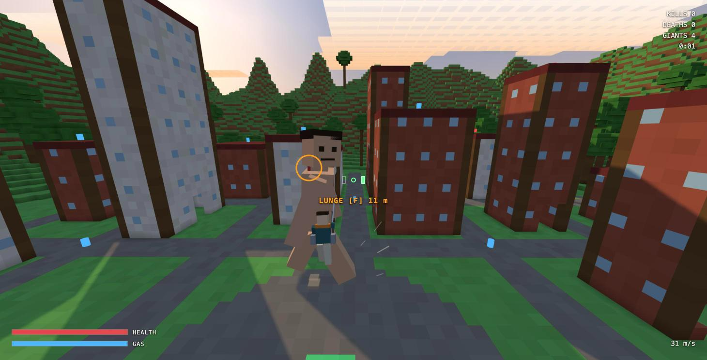

# Giantfall

Giants are walking into a block-built city. Swing between the buildings on two grappling hooks and cut them at the back of the neck. You are small and breakable: hit a wall too fast and you die.

**Play it in your browser:** https://narayanakash97.github.io/giantfall/

## Controls

| Key | Action |
| --- | --- |
| Mouse | Look and aim |
| Left / right click (hold) | Fire left / right hook |
| Shift | Reel in hard (uses gas) |
| Space | Jump. In the air: gas boost |
| G | Brake (uses a little gas) |
| W A S D | Walk. In the air: steer |
| F | Slash. Lunges at a neck within 18 m |
| V | First / third person |
| Esc | Pause |

Blue canisters refill gas. Red boxes heal. The green pad in the central square refills both. Brake before you land.

## How it was built

I am not a software engineer. I built this in one evening by describing what I wanted to Claude Code, playing it, and saying what felt wrong. The idea came from Nick Saraev's video [HOLY SH*T.. Claude just built me AOT x Minecraft video game](https://www.youtube.com/watch?v=LD0NxqDcDiY). The name, world and characters here are original.

The whole game is one HTML file using [three.js](https://threejs.org). There is no build step and nothing to install. Sound is generated in code.

To run it locally, open `index.html` in Chrome.
